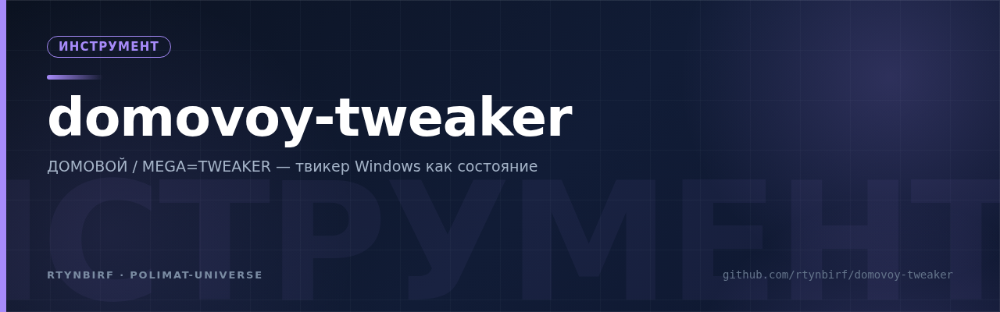
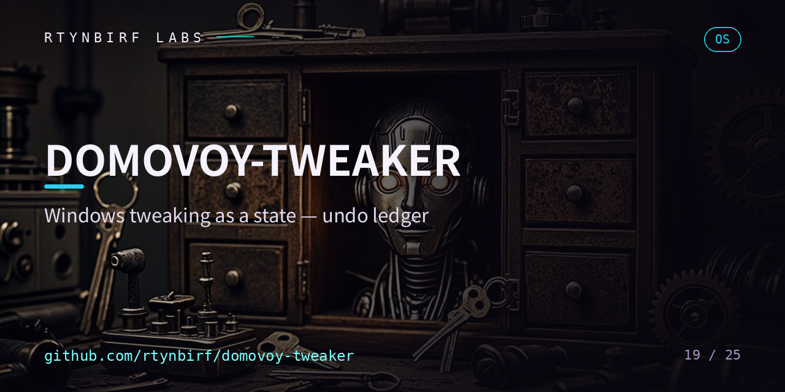

<div align="center">
  
</div>

# ДОМОВОЙ · МЕГА=ТВИКЕР

<p align="center"></p>


> Твикер Windows как **состояние**, а не **событие**. Прототип на PowerShell.


## Что это

Обычные твикеры — и все «учителя», у которых мы учились, — работают как **событие**:
нажал кнопку → применил твик → закрыл. Что именно изменилось в системе, что было ДО,
вернулось ли всё на место после очередного обновления Windows — не помнит никто.

ДОМОВОЙ устроен как дух дома: он ведёт хозяйство и **помнит всё**. Твик для него —
не клик, а **состояние**, зафиксированное в журнале, которое можно проверить,
откатить и защитить от дрейфа.

Родословная: прототип вырос из реверс-инжиниринга Modern Tweaker 2.0/3.0
(см. [кейс-стади](docs/analysis/modern-tweaker-case-study.md)) и изучения четырёх
мировых практик — Sophia Script, WinUtil, Win11Debloat, privacy.sexy
([сравнение](docs/comparison.md)).

## Четыре контура

| Контур | Что делает | Статус |
|---|---|---|
| 📜 **Журнал** (Ledger) | Каждое изменение: кто, когда, что было ДО, что стало ПОСЛЕ. Append-only JSONL, с v1.2 — tamper-evident: хеш-цепочка SHA-256 (№103), `Test-DomovoyLedgerIntegrity` | ✅ рабочий с v0.2 |
| 🔭 **Дозор** (Drift Sentinel) | Сравнивает фактическое состояние с зафиксированным — ловит откат твиков после обновлений Windows | скелет с v0.1, базовая линия из снимков в v0.4 |
| ⏪ **Машина времени** | Откат любой функции по отдельности, из снимка ДО, а не «снести всё» | ✅ рабочий с v0.2 |
| ✅ **Проверка эффекта** | Пробы (значение/отсутствие в реестре, тип запуска и статус службы) — прошло / не прошло, честно | базово работает с v0.2, полный в v0.5 |

## Принципы (без них смысла нет)

1. Твик = состояние в журнале, а не клик в интерфейсе.
2. Каждая функция обязана иметь откат из снимка, сделанного ДО применения.
3. Только документированные пути (реестр, службы, политики) — ссылка на источник в каждом манифесте.
4. Ничего не скачивается во время применения — нулевой Web-контур, прямой ответ на `WebClient.DownloadString` из 2.0.
5. Dry-run по умолчанию: без явного `-Apply` показывается только план изменений.
6. Идемпотентность: повторное применение ничего не ломает.
7. Код открыт и читается за вечер; каждое действие объясняет само себя.

## Структура репозитория

```
domovoy-tweaker/
├── README.md, LICENSE, CHANGELOG, CONTRIBUTING, CODE_OF_CONDUCT, SECURITY
├── .github/workflows/            # ci.yml + release.yml (тег → релиз)
├── docs/
│   ├── spec.md                   # техническая спецификация
│   ├── architecture.md           # четыре контура, схемы, алгоритмы
│   ├── roadmap.md                # вехи с критериями приёмки
│   ├── features.md               # ПОЛНЫЙ нумерованный каталог функций (104)
│   ├── comparison.md             # сравнение с Sophia/WinUtil/Win11Debloat/privacy.sexy
│   ├── audit/                    # ревизии: отчёты и ТЗ-дорожные карты
│   └── analysis/
│       └── modern-tweaker-case-study.md   # реверс-инжиниринг 2.0 → 3.0 (статика)
├── schema/                       # JSON-схемы: features / profiles / groups
├── config/
│   ├── features/                 # манифесты функций (58: службы, приватность, debloat, интерфейс, сеть, планировщик, shell)
│   ├── profiles/                 # профили cautious / standard (JSON, не скрипты)
│   └── groups/                   # группы функций с зависимостями (JSON)
├── src/Domovoy/                  # модуль PowerShell (54 публичные команды)
├── packaging/winget/             # шаблоны winget-манифестов + генератор
└── tests/                        # Pester
```

## Установка

Из PowerShell Gallery (одна команда, когда релиз опубликован в галерее):

```powershell
Install-Module -Name Domovoy -Scope CurrentUser
Import-Module Domovoy
```

Из zip-архива релиза (без `install.ps1` - он не нужен):

```powershell
# распаковать Domovoy-<версия>.zip (каталог манифестов внутри) и выполнить:
Import-Module .\Domovoy\Domovoy.psd1 -Force
```

Портативный EXE — один файл, без установки:

```text
Domovoy-<версия>-Portable.exe                 # двойной клик -> GUI (Show-Domovoy)
Domovoy-<версия>-Portable.exe Get-DomovoyFeature   # аргументы идут в CLI-шиму
Domovoy-<версия>-Portable.exe --selftest      # машинная проверка упаковки
Domovoy-<версия>-Portable.exe --extract C:\путь    # распаковать без запуска
```

Весь пакет (модуль, каталог функций, схемы, оба CLI-шима) встроен в exe:
он распакуется в `Domovoy-<версия>\` рядом с собой (если каталог только
для чтения — в `%LOCALAPPDATA%\Domovoy\app`) и откроет окно программы.
exe не подписан (сертификат — v1.6 п.4): SmartScreen покажет
«неизвестный издатель» — «Подробнее → Выполнить в любом случае»;
исходник, сборщик и проверка открыты:
`packaging/shim/DomovoyPortable.cs`, `tools/Build-PortableExe.ps1`,
`--selftest`.

Подробности (PSGallery-публикация, подпись кода, winget) - [docs/distribution.md](docs/distribution.md).

## Быстрый старт

```powershell
git clone https://github.com/rtynbirf/domovoy-tweaker.git
cd domovoy-tweaker
Import-Module ./src/Domovoy/Domovoy.psd1 -Force

Initialize-Domovoy
Get-DomovoyFeature                                        # каталог функций
Invoke-DomovoyFeature -Id services.diagtrack.disabled     # dry-run: план + снимок
Invoke-DomovoyFeature -Id services.diagtrack.disabled -Apply   # применить + записать в журнал
Get-DomovoyLedger                                         # что произошло
Test-DomovoyEffect -Id services.diagtrack.disabled        # пробы эффекта
Undo-DomovoyFeature -Id services.diagtrack.disabled -Apply     # откат из снимка
Invoke-DomovoyDriftScan                                   # есть ли дрейф

Get-DomovoyProfile                                        # профили: cautious / standard
Invoke-DomovoyProfile -Id cautious                        # суммарный dry-run-план профиля
Invoke-DomovoyProfile -Id cautious -Apply                 # применить профиль (одна точка восстановления)
Backup-DomovoyServiceState                                # экспорт таблицы служб в JSON

# Проверка эффекта как полный контур (v0.5.0)
$applied = Invoke-DomovoyFeature -Id policy.telemetry.level0 -Apply
$applied.Changes                                          # что реально изменилось: до/после по каждой пробе
Invoke-DomovoyCleanup                                     # отчёт «сколько освободим» (dry-run)
Get-DomovoyTelemetryReport                                # №15: фактические значения телеметрических политик
Get-DomovoyStartupInventory                               # №41: Run/RunOnce — только чтение
Get-DomovoyDriverInventory -Export                        # №45/42: инвентаризация + JSON-экспорт драйверов
Get-DomovoyBitLockerStatus                                # №49: состояние BitLocker по томам
Get-DomovoyChangeReport -Since (Get-Date).AddDays(-7)     # №63: что изменилось с момента X — по журналу
Invoke-DomovoyEventLogCleanup                             # №38: журналы событий — сначала отчёт, очистка только с -Apply
Invoke-DomovoyMemoryTrim                                  # №40: тримминг — честная пометка «эффект временный»
Invoke-DomovoySystemIntegrityCheck                        # №51: sfc/DISM с записью результата в журнал

# Авто-лечение и прозрачная сила (v0.6.0)
Invoke-DomovoyFeature -Id network.dns.cloudflare          # №34: DNS-профиль (cloudflare/quad9/google), dry-run
Invoke-DomovoyAutoHeal                                    # №58: dry-run — кто дрейфует и будет вылечен
Invoke-DomovoyAutoHeal -Apply                             # №58: вылечить: снапшот дрейфа → ре-apply → журнал
Register-DomovoyWatchdog -Apply                           # №58: opt-in задача планировщика на каждый день
Unregister-DomovoyWatchdog -Apply                         # №58: выключить дозор
Get-DomovoyPrivilege                                      # №52: привилегии токена — честная таблица
Enable-DomovoyPrivilege -Name SeTakeOwnershipPrivilege -Apply   # №52: включение — в журнал
Set-DomovoyFileOwner -Path C:\path\file -Owner 'BUILTIN\Administrators' -Apply  # №48: владелец с undo
Undo-DomovoyFileOwner -Apply                              # №48: прежний владелец из журнала
Invoke-DomovoyFileAttributeClear -Path C:\path\file -Attributes Hidden -Apply   # №47: снятие атрибутов
Undo-DomovoyFileAttributeClear -Apply                     # №47: прежние атрибуты из журнала
Invoke-DomovoyDriverDedup                                 # №43: старые дубликаты драйверов — отчёт
Invoke-DomovoyDriverDedup -Apply                          # №43: бэкап .cab → удаление (без бэкапа — ни шага)
Backup-DomovoyBitLockerKey -MountPoint C: -OutFile D:\keys\c.txt -Apply         # №50: ключ BitLocker в файл
```

Требуется Windows 10/11, PowerShell 5.1 или 7+; для `-Apply` — сессия с правами администратора.

## Локальная проверка одним кликом

Запустите [DOMOVOY-ONECLICK.bat](DOMOVOY-ONECLICK.bat) — он сам склонирует
(или обновит) локальную копию репозитория в `%USERPROFILE%\domovoy-tweaker`,
поставит Pester 5.7.1 и PSScriptAnalyzer, прогонит зеркало CI
(PSScriptAnalyzer с гейтом Error, Pester, JSON-схемы, верификация упаковки)
и соберёт локальный `Domovoy-<версия>.zip` с `.sha256`. Артефакты и логи —
в `%LOCALAPPDATA%\Domovoy\`, репозиторий не изменяется, права администратора
не нужны (UAC возможен только если git отсутствует и ставится через winget).

## Дорожная карта

Вехи с критериями приёмки — в [docs/roadmap.md](docs/roadmap.md).
Сейчас: **v1.5.0** — 104 записи каталога, 58 эталонных манифестов на 13 op-типах,
54 публичные команды. Операции контекстного меню и «Открыть с помощью» (№81)
с точным восстановлением регистрации; №77 и №95 (переносы из v1.2) закрыты;
группы функций с зависимостями поверх профилей (№102); явная миграция журнала
между версиями схемы (№101); аудит shell-расширений (№104). Журнал
tamper-evident: хеш-цепочка SHA-256 и `Test-DomovoyLedgerIntegrity` (№103).
CI доказывает обещания: гейт упаковки каталога, документ-гейт, PS 5.1-нога,
покрытие + NUnit-артефакты, релиз только с зелёного коммита (v1.5).
Дальше: v1.6 — дистрибуция по-взрослому (PSResourceGet, winget, подпись).
Полная ревизия проекта и ТЗ всего недоделанного —
[docs/audit/](docs/audit/2026-11-03-revizor-report.md).

## Отказ от ответственности

Прототип. Менять реестр и службы — значит брать на себя ответственность за свою систему.
Создавайте точки восстановления (модуль при `-Apply` делает это сам).
Проект не аффилирован с Microsoft. Windows — товарный знак Microsoft.

## Лицензия

[MIT](LICENSE).

<details>
<summary>English summary</summary>

Domovoy ("house spirit") is a Windows tweaker prototype that treats a tweak as a
*state*, not an *event*: an append-only change ledger, per-feature undo from
pre-change snapshots, a drift sentinel that detects rollbacks after Windows
Updates, and effect-verification probes. It grew from static reverse-engineering
of Modern Tweaker 2.0/3.0 and lessons from Sophia Script, WinUtil, Win11Debloat
and privacy.sexy. PowerShell 5.1+/7, dry-run by default, no runtime downloads.
See `docs/` for the spec, architecture, roadmap and the full numbered feature catalog.
</details>
