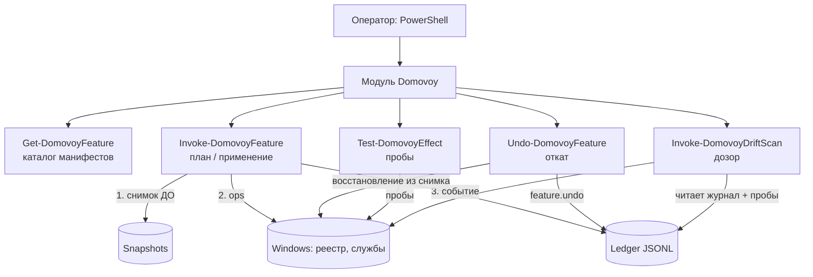
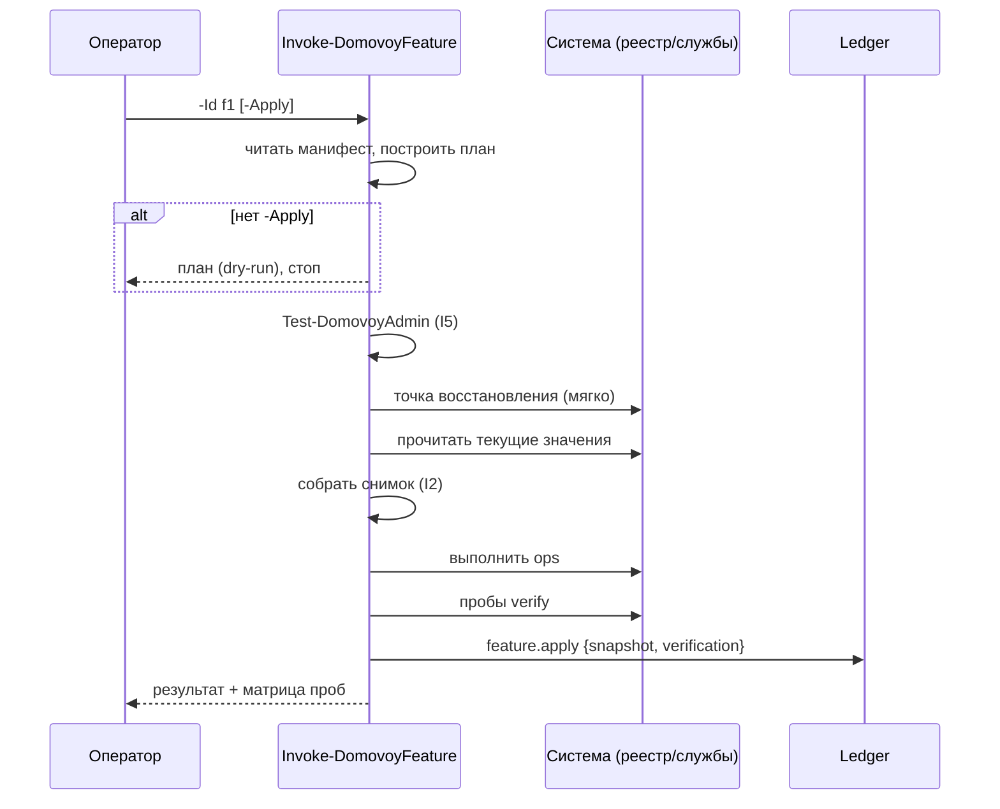

# Архитектура ДОМОВОЙ

Версия документа: 0.1.0 · Обновлён: 2026-11-02

---

## 1. Обзор

ДОМОВОЙ — PowerShell-модуль без сети, без внешних зависимостей, без бинарников.
Всё декларативное — манифесты JSON; всё императивное — несколько сотен строк
читаемого PowerShell.



Ключевой принцип: **система описывается данными, а не кодом**. Манифест функции
одинаково читается человеком, модулем, тестами и (в будущем) экспортёром в GPO/Intune.

---

## 2. Четыре контура

### 2.1. 📜 Журнал (Ledger)

- Формат: JSONL — по событию на строку. Причины: дописывание без блокировок,
  разбор построчно, устойчивость к обрыву процесса (битая строка не рушит журнал).
- События: `ledger.init` → `feature.apply` → `feature.undo` → …
- Каждое событие несёт снимок ДО и результат верификации ПОСЛЕ.
- Append-only (инвариант I1): журнал — это свидетельство, а не рабочая таблица.

### 2.2. ⏪ Машина времени (per-feature undo)

Undo работает **из снимка**, а не из «универсального бэкапа»: восстанавливается
ровно то, что меняла конкретная функция, с точными прежними значениями и типами.
Это даёт «откат по-функционально» — то, чего нет ни у одного из учителей.

- Снимок собирается до первой операции (I2).
- «Значения не было» → при undo значение удаляется.
- Dry-run показывает снимок до восстановления.

### 2.3. 🔭 Дозор (Drift Sentinel)

Сценарий: пользователь отключил телеметрию; накопительное обновление Windows
вернуло политику; никто не заметил.

- v0.1: базовая линия = ожидаемое из манифеста.
- v0.4: базовая линия = последний verified-снимок; отчёт «что откатилось с момента X».
- v0.6: авто-лечение — всегда opt-in, никогда по умолчанию.

### 2.4. ✅ Проверка эффекта (Verification)

Проба = минимальный вопрос к системе: «какое значение? какой тип запуска?».
Матрица `{probe, target, expected, actual, pass}` возвращается всегда.
FAIL — не ошибка, а честный ответ; в журнал он попадает тоже.

---

## 3. Компоненты модуля

| Компонент | Слой | Ответственность |
|---|---|---|
| `Get-DomovoyFeature` | Public | каталог манифестов, фильтр |
| `Invoke-DomovoyFeature` | Public | план / apply по алгоритму spec §6.1 |
| `Undo-DomovoyFeature` | Public | undo из журнала+снимка |
| `Get-DomovoyLedger` | Public | чтение JSONL с фильтрами |
| `Invoke-DomovoyDriftScan` | Public | дозор |
| `Test-DomovoyEffect` | Public | пробы |
| `Backup-DomovoySnapshot` | Public | явный снимок в файл |
| `New-DomovoyRestorePoint` | Public | точка восстановления ОС |
| `Initialize-Domovoy` | Public | хранилище + генезис |
| `Read-FeatureManifest` | Private | валидация обязательных полей |
| `Get-DomovoyStorePath` | Private | пути хранилища (`DOMOVOY_STORE`) |
| `Test-DomovoyAdmin` | Private | elevation-проверка |
| `Write-DomovoyLedgerEntry` | Private | append-only запись события |
| `Get-RegistryValueSafe` | Private | чтение значения реестра без исключений |

---

## 4. Поток apply (последовательность)



---

## 5. Хранилище на диске

```text
%ProgramData%\Domovoy\            (или $env:DOMOVOY_STORE)
├── ledger.jsonl
└── snapshots/<featureId>/<yyyyMMdd-HHmmss>.json
```

Резервные копии пользовательских файлов (после v0.3) — `backups/`.

---

## 6. Расширяемость: правило четырёх проекций

Новый тип операции принимается в проект только если для него определены все
четыре проекции:

| Проекция | Вопрос |
|---|---|
| **op** | как применить? |
| **probe** | как проверить, что применилось? |
| **snapshot** | что запомнить ДО? |
| **undo** | как вернуть из снимка? |

Планируемые op-типы и их статус — в `roadmap.md` (§ v0.2–v0.5) и `features.md`.

---

## 7. Почему манифесты, а не код

1. **Проверяемость**: манифест валидируется схемой и тестами без запуска системы.
2. **Прозрачность**: твик читается как строка данных, а не как ветка кода.
3. **Генерируемость**: декларативное описание можно экспортировать в GPO/Intune (v0.7) —
   прямое развитие GPO-слоя, замеченного в Modern Tweaker 3.0.
4. **Ревью**: PR на новый твик — это diff JSON, видимый целиком.
